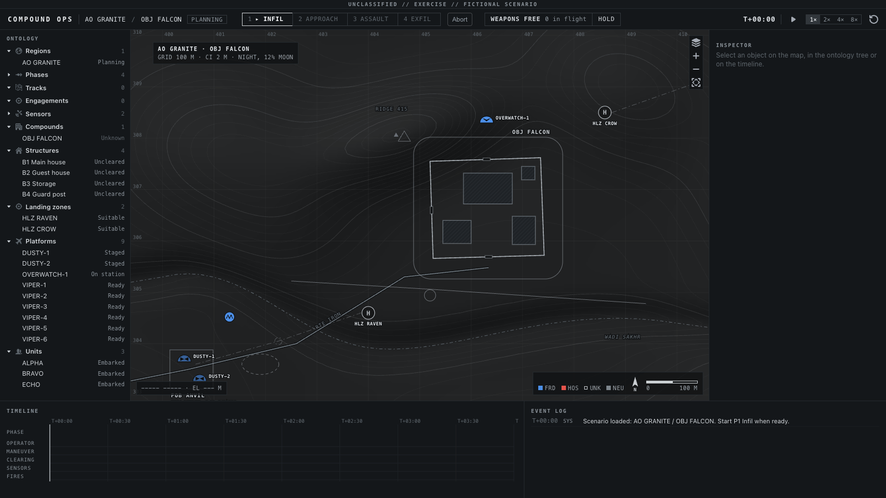

# Compound Ops

A fictional special-operations raid console built around a small Palantir-style **ontology**, a real **multi-sensor tracker** and an **autonomous FPV strike cell**. UI built with [Blueprint](https://blueprintjs.com), map symbology in the style of MIL-STD-2525.



## Sensor fusion

- **Sensors:** a rotating ground radar (range/bearing noise, false alarms) and a UAV EO/IR camera staring at the objective.
- **Tracker:** two-model **IMM** Kalman filter (constant velocity + maneuver), chi-square gating, global nearest neighbour association, tentative → confirmed → coasting → dropped lifecycle, duplicate-track merging.
- **Blue force suppression:** plots that match a friendly position under the measurement covariance are dropped before tracking.
- **Result** (`npm run smoke`, first mission): position RMS 14.6 m for raw radar plots, 3.7 m for EO plots, **8.6 m for fused tracks**.

## Autonomy

- **Pathing:** A* on a 2 m grid built from the compound wall, gates and building footprints. Teams cross the wall only at gates and enter buildings only at their doors.
- **Assault and Exfil:** after the operator presses Assault, the teams split the buildings between themselves by route length, clear them and hold in place once the compound is secured. Exfil runs the same way.
- **Threat assessment:** every confirmed track is assessed by rule. Inside OBJ FALCON means hostile, closing on an LZ at vehicle speed means hostile, and a slow walker well outside the objective is marked neutral and protected.
- **FPV strike cell:** the nearest ready drone is assigned to each hostile track and flies a lead-pursuit intercept. Each decision becomes an **Engagement** object with its rationale, rule checks and outcome, and a hit drops the track.
- **Rules of engagement:** neutral and unknown tracks are never engaged, and nothing within 50 m of a friendly is struck (a launch needs 60 m, a drone holds off at 56 m, and a final check runs at impact). One click on **WEAPONS HOLD** stops new engagements and recalls every drone in flight.

## Ontology

- **Objects:** Region, Phase, Track, Engagement, Sensor, Detection, Compound, Structure, Landing zone, Platform, Unit
- **Links:** track → supporting detections → sensor, track → structure, engagement → target track and effector, helicopter → carried units, unit → objective
- **Actions:** start phase, weapons hold / free, classify track, mark LZ risky, abort

## Smoke test

`npm run smoke` flies three headless missions and fails if any of these happens:

- a unit or person is inside a building, or crosses the wall away from a gate
- the operator has to act during the assault, or a team moves after it without an order
- the shepherd is struck or assessed hostile
- an impact lands within 50 m of a friendly
- a hostile survives the mission
- WEAPONS HOLD does not recall the drones already in flight

## Run

```bash
npm install
npm run dev
npm run smoke
```

The demo GIF is rendered frame by frame from `?capture` mode with `node scripts/record-demo.mjs frames` (needs Chrome and the dev server on port 5317), then encoded with ffmpeg at full 1600 px width with a single 256-color palette, no downscaling.

All names, places and coordinates are invented.
