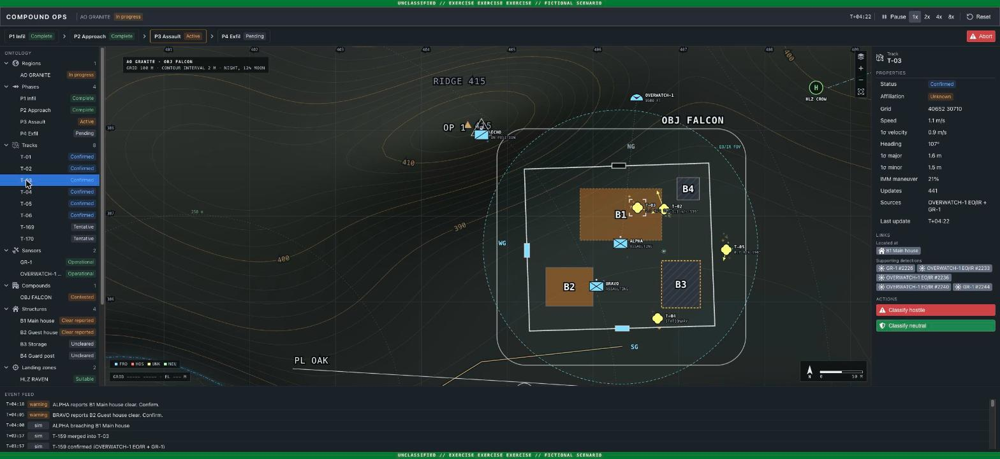
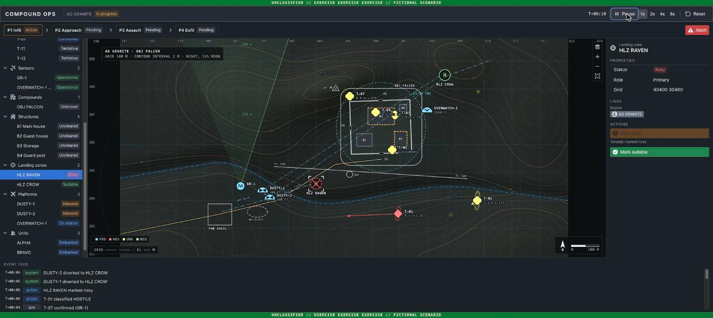

# Compound Ops

A fictional special-operations raid console built around a small Palantir-style **ontology** and a real **multi-sensor tracker**. UI built with [Blueprint](https://blueprintjs.com), map symbology in the style of MIL-STD-2525.



## Sensor fusion

- **Sensors:** a rotating ground radar (range/bearing noise, false alarms) and a UAV EO/IR camera staring at the objective.
- **Tracker:** two-model **IMM** Kalman filter (constant velocity + maneuver), chi-square gating, global nearest neighbour association, tentative → confirmed → coasting → dropped lifecycle, duplicate-track merging.
- **Blue force suppression:** plots that match a friendly position under the measurement covariance are dropped before tracking.
- **Result** (`npm run smoke`): position RMS 13.0 m for raw radar plots, 3.5 m for EO plots, **5.8 m for fused tracks**.

## Ontology

- **Objects:** Region, Phase, Track, Sensor, Detection, Compound, Structure, Landing zone, Platform, Unit
- **Links:** track → supporting detections → sensor, track → structure it sits on, helicopter → carried units, unit → objective
- **Actions:** start phase, classify track, assign objective, confirm cleared, mark LZ risky, abort

A hostile vehicle closing on the primary LZ raises an alert. Marking the LZ risky re-links both helicopters to the alternate, and the assault teams then pick the gate nearest to their new landing site:



## Run

```bash
npm install
npm run dev
npm run smoke
```

All names, places and coordinates are invented.
